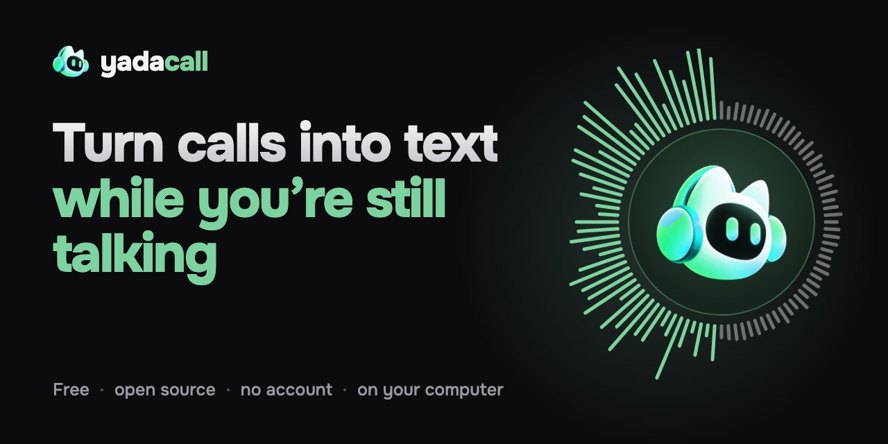
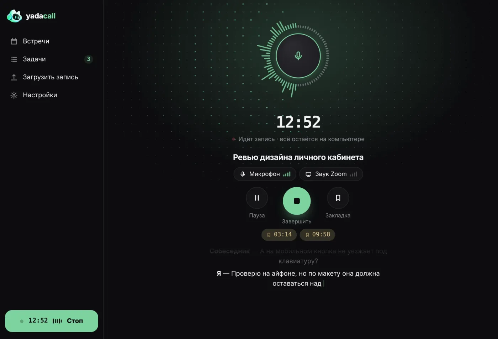
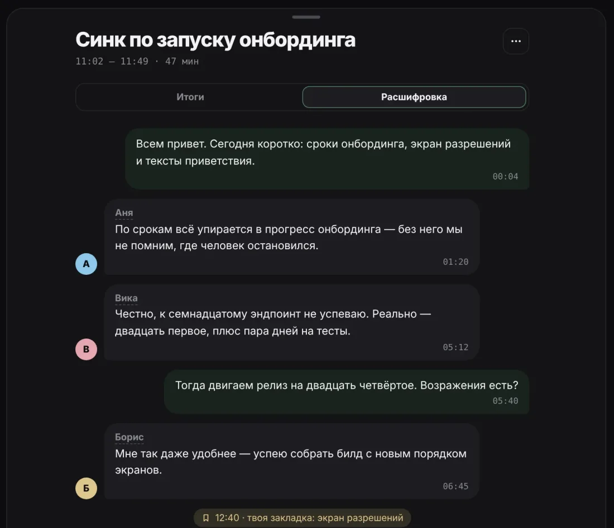
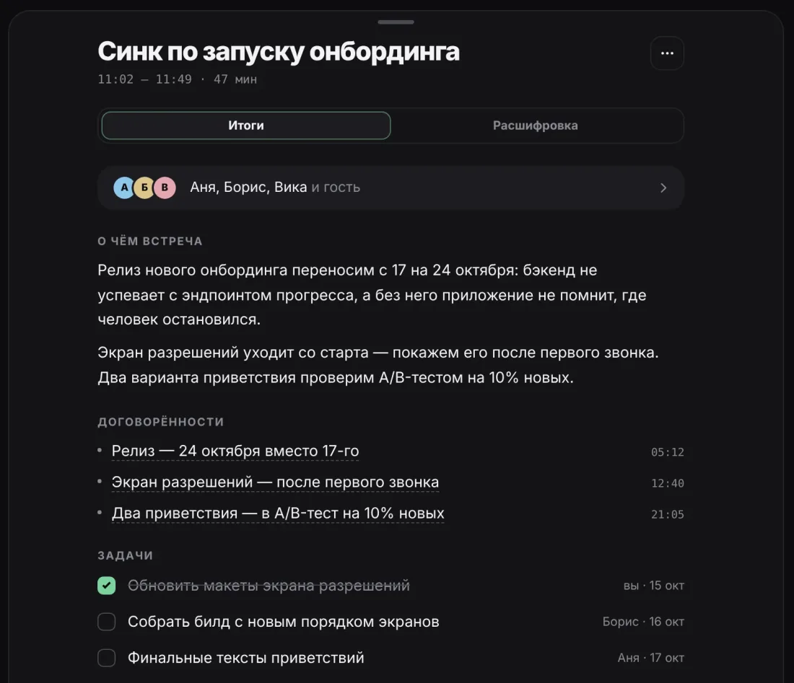
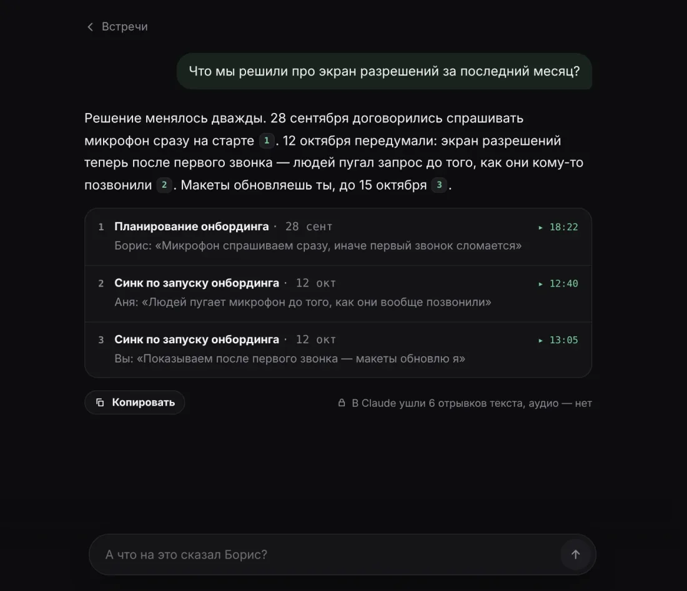
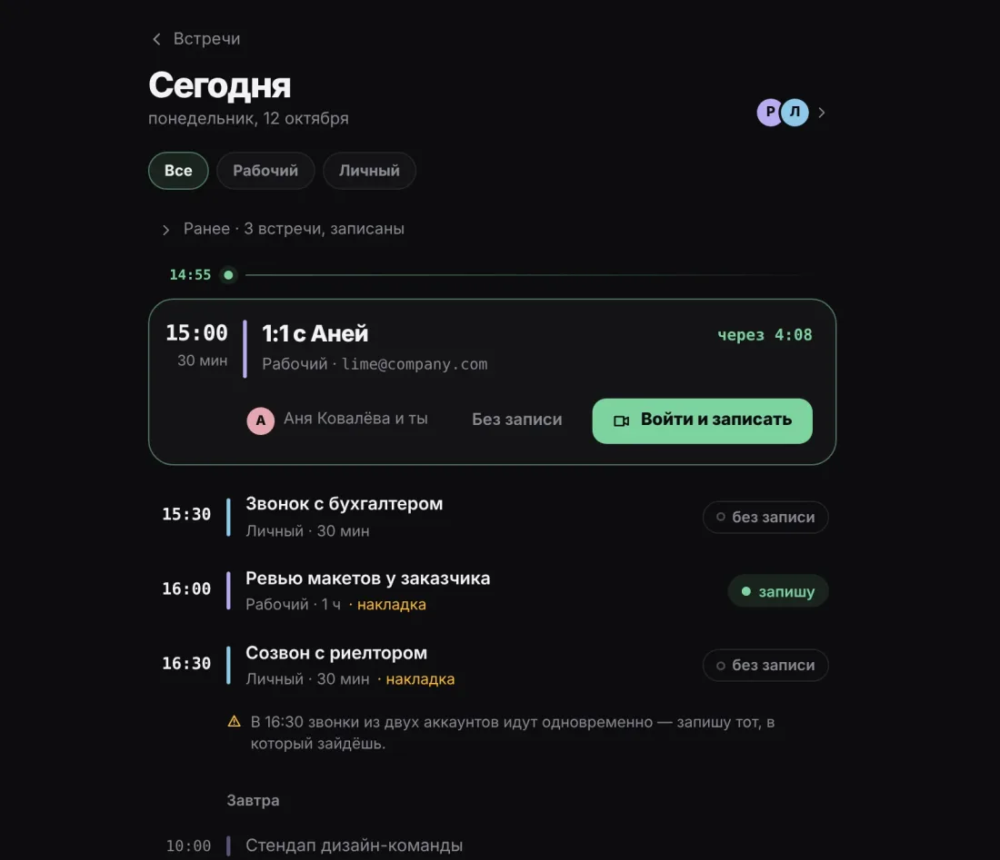
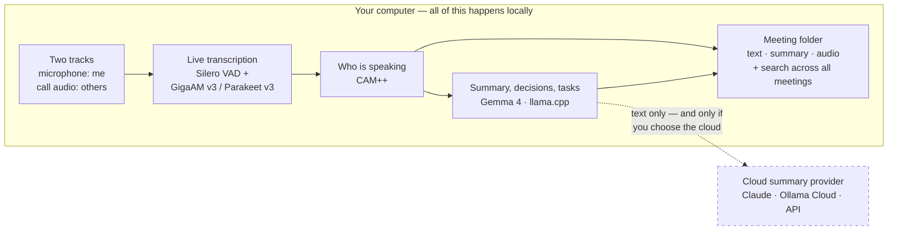

<div align="center"><a href="README.md">Русский</a> · <b>English</b></div>

<br>

<div align="center">

<a href="https://limeflash.github.io/yadacall/en/"></a>

<br>

**Records calls on two separate tracks and transcribes them while you're still talking.**<br>
All on your computer: audio never leaves it — no bot in the call, no account, no telemetry.

<br>

<a href="https://github.com/limeflash/yadacall/releases/latest"></a>&nbsp;<a href="https://limeflash.github.io/yadacall/en/"></a>

<br>

<a href="https://github.com/limeflash/yadacall/releases/latest"></a> <a href="https://github.com/limeflash/yadacall/releases"></a> <a href="LICENSE"></a>   

<br>

[Features](#features) &nbsp;·&nbsp; [How it works](#how-it-works) &nbsp;·&nbsp; [Install](#install) &nbsp;·&nbsp; [Under the hood](#under-the-hood) &nbsp;·&nbsp; [Privacy](#privacy) &nbsp;·&nbsp; [Build](#build-from-source)

</div>

<br>

<p align="center">
  
  <br>
  <sub>Screenshots show the Russian interface; the app is available in English too.</sub>
</p>

## Why YadaCall

<table>
<tr>
<td width="33%" valign="top">

**Text appears while you talk**<br>
Lines show up as the conversation goes. Hit Stop and the transcript is ready in seconds, not minutes. No internet needed.

</td>
<td width="33%" valign="top">

**Audio stays with you**<br>
No account, no telemetry, no bot in your call. The other side sees nothing — nothing joins the call.

</td>
<td width="33%" valign="top">

**Light and open**<br>
Rust and the system WebView — no Electron, ffmpeg or Python. Every meeting is a plain folder of files. Free, MIT.

</td>
</tr>
</table>

<table align="center">
<tr align="center">
<td><b>21&nbsp;MB</b><br><sub>macOS installer</sub></td>
<td><b>20–26×</b><br><sub>faster than real time (Russian)</sub></td>
<td><b>25</b><br><sub>languages, offline</sub></td>
<td><b>0</b><br><sub>accounts, telemetry or bots</sub></td>
</tr>
</table>

<p align="center"><sub>Works with any call — Google Meet, Zoom, Telegram, Teams, Slack, Discord, Telemost — in the browser or in an app. Speeds measured on a MacBook Pro M1 Pro, 16 GB.</sub></p>

## Features

<table>
<tr>
<td width="50%" valign="top">

<br><b>Two tracks — see who said what at a glance</b><br>
You and the others are on separate tracks, so one-on-one calls never get mixed up. In group calls voices are labeled on-device, familiar voices are recognized from past meetings, and names come from the calendar invite.
</td>
<td width="50%" valign="top">

<br><b>Decisions and tasks — each with a timestamp</b><br>
What the meeting was about, who does what by when, what's still open. Click any item to jump to that moment. Templates for regular meetings, stand-ups, 1:1s and interviews.
</td>
</tr>
<tr>
<td width="50%" valign="top">

<br><b>Ask all your meetings at once</b><br>
Answers come with citations [1][2], each linking to the right meeting and moment. Search understands meaning and Russian word forms; tasks from every meeting live on one screen. The app shows exactly what went out: “6 text fragments to Claude, no audio.”
</td>
<td width="50%" valign="top">

<br><b>Join and record — one button</b><br>
Several Google accounts at once — work and personal. A reminder 1, 2 or 5 minutes ahead opens Meet in the right account and starts recording. Any other calendar via an ICS link: Yandex, Outlook, iCloud.
</td>
</tr>
</table>

<details>
<summary><b>All features</b></summary>

<br>

- **On-device transcription during the call** — GigaAM v3 for Russian (≈ 20–26× faster than real time on an M1 Pro), Parakeet v3 for 25 languages. Hit Stop and the text is ready in seconds; an hour of audio transcribed afterwards takes 2–3 minutes.
- **Two tracks, no virtual drivers** — Core Audio taps on macOS, WASAPI loopback on Windows, PulseAudio/PipeWire on Linux. A recording survives an app crash (a couple of seconds lost at most) and swapping headphones mid-call. With Bluetooth headphones it records the built-in mic, so the call doesn't drop into low-quality headset mode.
- **Term dictionary** — “Google Mit” → “Google Meet”, “jira” → “Jira”: a built-in list plus your own words. Filters for recognition “hallucinations” and echo.
- **Warns about a silent track** — wrong mic, or the call moved to your phone.
- **Speaker labeling** in group calls and recognition of familiar voices from past meetings; names come from the calendar invite.
- **Summaries, decisions and tasks** linked to the moment in the conversation — your choice: local (Gemma 4 via llama.cpp), Ollama (including cloud models with a subscription), Claude, any OpenAI-compatible API — or no summaries at all.
- **Ask all your meetings** — hybrid search (full-text + meaning) and an answer with citations; you can see what went to the cloud.
- **Google Calendar** (several accounts) — a reminder before the call, “Join and record” in the right account; notices calls that aren't in the calendar; ICS links for Yandex, Outlook, iCloud.
- **“Will it run?” before you download** — a forecast for your hardware for every model (“≈ 39 tok/s · 3.5 of 16 GB”), multi-stream downloads that resume and verify sha256.
- **Plain files** — each meeting is a folder with `transcript.md`, `transcript.json`, a summary and audio (FLAC). Keep audio: don't keep / 7 / 30 days / forever — text and summaries stay. Export to Markdown and JSON.
- **Everything at hand** — record from the tray, a mini player on top of windows, pause and bookmarks during a call, import of existing audio and video, dark and light themes, English and Russian UI, auto-update.

</details>

### Summaries — you choose where they're made

| Option | How it works |
|---|---|
| **On your computer** | Gemma 4 via llama.cpp — a short meeting's summary in about 40 seconds, offline |
| **Via Ollama** | Local models, or cloud models with an Ollama subscription — 6–10 seconds, no keys |
| **Via API** | Claude, OpenRouter, Ollama Cloud, LM Studio or any OpenAI-compatible server |
| **No summaries** | Transcript only |

Only text goes to the cloud — and only if you pick a cloud provider. Audio never does.

### “Will it run?” — before you download

YadaCall measures your CPU, memory and Neural Engine and predicts how each model will run on your hardware. After download it runs a real benchmark and refines the forecast.

| Model | Purpose | Forecast |
|---|---|---|
| GigaAM v3 · ~230 MB | Russian transcription | ≈ 26× real time |
| Parakeet TDT v3 | 25 languages | ≈ 22× real time |
| Gemma 4 E2B · ~2.8 GB | summaries on your computer | ≈ 39 tok/s · 3.5 of 16 GB |
| A bigger model | when memory runs short | Won't fit |

<sub>Measured on a MacBook Pro M1 Pro, 16 GB. 6-stream downloads, resume after drops, sha256 check, hf-mirror.</sub>

## How it works

Everything inside the “Your computer” box happens locally. Only text can go out — and only if you chose a cloud summary provider.



Every meeting is a plain folder — take it and open it in any editor, no YadaCall needed:

```text
~/YadaCall/2026-10-12 14-30 Onboarding launch sync/
├── meeting.json       title, time, bookmarks, participants
├── transcript.md      transcript with timestamps — readable by people and by Claude
├── transcript.json    lines: time, speaker, track, text
├── summary.json       summary, decisions, tasks, open questions
└── audio/             mic.flac and them.flac — per your audio retention setting
```

<sub>The library folder is configurable and the search index (SQLite) can be rebuilt from the files. Details in <a href="docs/ARCHITECTURE.md">docs/ARCHITECTURE.md</a>.</sub>

## Install

Download the file for your system from the [Releases](https://github.com/limeflash/yadacall/releases/latest) page.

| System | File | Notes |
|---|---|---|
| **macOS** 14.2+ (Apple Silicon) | `YadaCall_*_aarch64.dmg` | The build isn't signed with an Apple certificate yet: on first launch right-click the app → “Open”, or run `xattr -dr com.apple.quarantine /Applications/YadaCall.app`. |
| **Windows** 10/11 x64 | `YadaCall_*_x64-setup.exe` or `.msi` | SmartScreen will warn about an unknown publisher: “More info” → “Run anyway”. |
| **Linux** x64 (Ubuntu 24.04+ and similar) | `.AppImage` or `.deb` | Needs PulseAudio or PipeWire. |

Models are downloaded on first launch (transcription ≈ 230 MB; Gemma 4 E2B for local summaries ≈ 2.8 GB — optional). Updates arrive inside the app.

> [!NOTE]
> Google Calendar sign-in is currently in testing mode on Google's side (a limited set of accounts). Everyone else can subscribe to a calendar via an ICS link — that works for everyone.

## Under the hood

**Stack:** Rust · Tauri 2 · Svelte 5 · ONNX Runtime · llama.cpp · SQLite (FTS5 + sqlite-vec). Builds for all three OSes run in GitHub Actions.

| Job | Model | Author |
|---|---|---|
| Russian transcription | **GigaAM v3** | Sber |
| Transcription, 25 European languages | **Parakeet TDT v3** | NVIDIA |
| Speech boundaries | **Silero VAD** | Silero |
| Who is speaking | **CAM++** | 3D-Speaker |
| Search by meaning | **multilingual-E5** | Microsoft |
| Summaries on your computer | **Gemma 4** | Google |

<sub>Model licenses are listed in <a href="catalog/models.json">catalog/models.json</a>. Models are downloaded on first launch rather than shipped in the installer.</sub>

<details>
<summary><b>Repository layout</b></summary>

<br>

| Path | What's inside |
|---|---|
| `apps/desktop` | Tauri 2 shell + Svelte 5 UI |
| `apps/cli` | command-line version on the same engine |
| `crates/yc-audio` | audio capture, resampling, crash-safe recording |
| `crates/yc-ml` | ONNX adapters: VAD, transcription, speakers, embeddings |
| `crates/yc-llm` | summary providers, prompts, answers with citations |
| `crates/yc-store` | SQLite index: full-text and vectors |
| `crates/yc-hub` | model catalog, hardware probe, downloader |
| `crates/yc-engine` | orchestration: recording, live transcription, job queue |
| `site/` | Astro landing page ([limeflash.github.io/yadacall](https://limeflash.github.io/yadacall/en/)) |

</details>

## Privacy

<table>
<tr>
<th width="50%" align="left">Stays with you</th>
<th width="50%" align="left">Goes online — and only this</th>
</tr>
<tr>
<td valign="top">

- Audio from both tracks — processed only on your computer
- Meetings — as plain files: transcript, summary and audio
- API keys and tokens — in Keychain / Credential Manager

</td>
<td valign="top">

- Model and app update downloads
- Calendar requests — if connected, read-only
- Transcript text — only with a cloud summary provider

</td>
</tr>
</table>

No telemetry, no analytics, no account. More in the [privacy policy](https://limeflash.github.io/yadacall/en/privacy/).

## Build from source

```bash
git clone https://github.com/limeflash/yadacall && cd yadacall/apps/desktop
pnpm install && pnpm tauri build --bundles app
```

You need Rust (the version is pinned in `rust-toolchain.toml`), Node LTS and pnpm; no C++ toolchain required.

**CLI** for experiments:

```bash
cargo run -p yadacall-cli -- --help
```

Commands: `transcribe`, `bench-asr`, `models`, `hw`, `summarize`, `record`, `google`, `detect-call`.

## Docs

[Architecture](docs/ARCHITECTURE.md) &nbsp;·&nbsp; [Releasing](docs/RELEASING.md) &nbsp;·&nbsp; [Your own Google OAuth client](docs/GOOGLE_OAUTH.md) &nbsp;·&nbsp; [Privacy policy](https://limeflash.github.io/yadacall/en/privacy/)

## License

[MIT](LICENSE) — free and open source.
