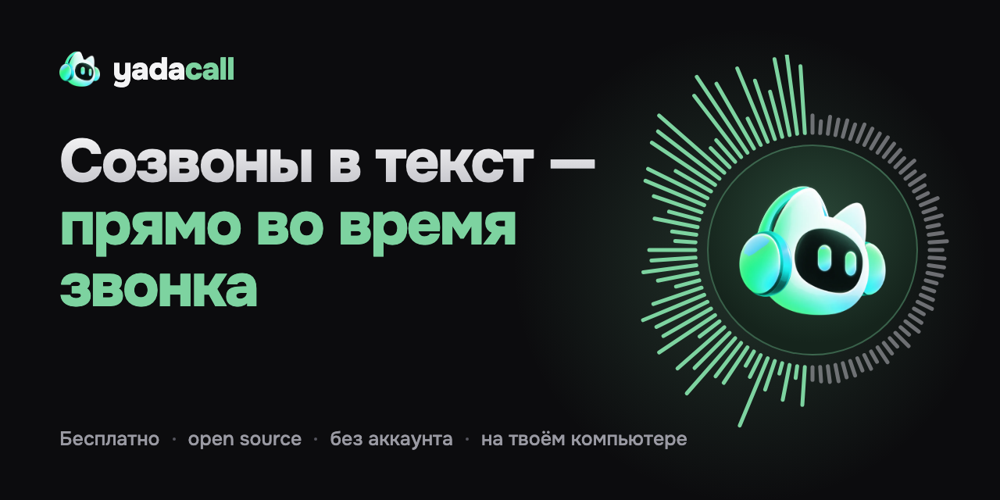
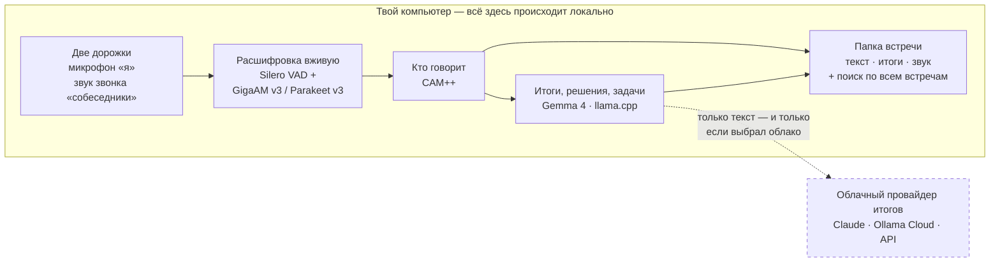

<div align="center"><b>Русский</b> · <a href="README.en.md">English</a></div>

<br>

<div align="center">

<a href="https://limeflash.github.io/yadacall/"></a>

<br>

**Записывает созвоны двумя дорожками и расшифровывает их прямо во время звонка.**<br>
Всё на твоём компьютере: звук никуда не уходит — ни бота в звонке, ни аккаунта, ни телеметрии.

<br>

<a href="https://github.com/limeflash/yadacall/releases/latest"></a>&nbsp;<a href="https://limeflash.github.io/yadacall/"></a>

<br>

<a href="https://github.com/limeflash/yadacall/releases/latest"></a> <a href="https://github.com/limeflash/yadacall/releases"></a> <a href="LICENSE"></a>   

<br>

[Возможности](#возможности) &nbsp;·&nbsp; [Как это работает](#как-это-работает) &nbsp;·&nbsp; [Установка](#установка) &nbsp;·&nbsp; [Под капотом](#под-капотом) &nbsp;·&nbsp; [Приватность](#приватность) &nbsp;·&nbsp; [Сборка](#сборка-из-исходников)

</div>

<br>

<p align="center">
  
</p>

## Почему YadaCall

<table>
<tr>
<td width="33%" valign="top">

**Текст — пока вы говорите**<br>
Реплики появляются по ходу разговора. Нажал «Стоп» — расшифровка готова за секунды, а не за минуты. Работает без интернета.

</td>
<td width="33%" valign="top">

**Звук остаётся у тебя**<br>
Без аккаунта, без телеметрии, без бота в звонке. Собеседники ничего не видят — в звонок ничего не подключается.

</td>
<td width="33%" valign="top">

**Лёгкое и открытое**<br>
Rust и системный WebView — без Electron, ffmpeg и Python. Каждая встреча — обычная папка с файлами. Бесплатно, MIT.

</td>
</tr>
</table>

<table align="center">
<tr align="center">
<td><b>21&nbsp;МБ</b><br><sub>установщик для macOS</sub></td>
<td><b>20–26×</b><br><sub>быстрее реального времени (русский)</sub></td>
<td><b>25</b><br><sub>языков без интернета</sub></td>
<td><b>0</b><br><sub>аккаунтов, телеметрии и ботов</sub></td>
</tr>
</table>

<p align="center"><sub>Работает с любым звонком — Google Meet, Zoom, Telegram, Teams, Slack, Discord, Телемост — в браузере или в приложении. Замеры скорости — на MacBook Pro M1 Pro, 16 ГБ.</sub></p>

## Возможности

<table>
<tr>
<td width="50%" valign="top">

<br><b>Две дорожки — сразу видно, кто что сказал</b><br>
Ты и собеседники на разных дорожках, поэтому в звонке один на один ошибок нет. В групповых голоса размечаются на устройстве, знакомых YadaCall узнаёт по прошлым встречам, имена подсказывает приглашение в календаре.
</td>
<td width="50%" valign="top">

<br><b>Договорённости и задачи — с таймкодом у каждого пункта</b><br>
О чём встреча, кто что делает и к какому сроку, что осталось открытым. Клик по пункту — и ты в этом моменте разговора. Шаблоны: обычная встреча, стендап, 1:1, интервью.
</td>
</tr>
<tr>
<td width="50%" valign="top">

<br><b>Спроси сразу у всех встреч</b><br>
Ответ с цитатами [1][2] — каждая ведёт в нужную встречу и момент. Поиск понимает русскую морфологию и смысл; задачи из всех встреч — на одном экране. Приложение показывает, что именно ушло в облако: «6 фрагментов текста в Claude, аудио — нет».
</td>
<td width="50%" valign="top">

<br><b>«Войти и записать» — одной кнопкой</b><br>
Несколько аккаунтов Google сразу — рабочий и личный. Напомнит за 1, 2 или 5 минут, откроет Meet в нужном аккаунте и начнёт запись. Любой другой календарь — по ICS-ссылке: Яндекс, Outlook, iCloud.
</td>
</tr>
</table>

<details>
<summary><b>Все возможности</b></summary>

<br>

- **Расшифровка на устройстве во время звонка** — GigaAM v3 для русского (≈ 20–26× быстрее реального времени на M1 Pro), Parakeet v3 для 25 языков. После «Стоп» текст готов за секунды; час записи, если расшифровывать после, обрабатывается за 2–3 минуты.
- **Две дорожки без виртуальных драйверов** — Core Audio taps на macOS, WASAPI loopback на Windows, PulseAudio/PipeWire на Linux. Запись переживает падение приложения (теряется не больше пары секунд) и смену наушников. С Bluetooth-наушниками пишет встроенный микрофон, чтобы звонок не проваливался в режим гарнитуры.
- **Словарь терминов** — «Google Mit» → «Google Meet», «джира» → «Jira»: встроенный список плюс свои слова. Фильтры «галлюцинаций» распознавания и эха.
- **Предупреждает, если дорожка молчит** — не тот микрофон или звонок ушёл на телефон.
- **Разметка голосов** в групповых звонках и узнавание знакомых по прошлым встречам; имена подсказываются из приглашения в календаре.
- **Итоги, решения и задачи** со ссылками на момент разговора — на выбор: локально (Gemma 4 через llama.cpp), через Ollama (в т. ч. облачные модели по подписке), Claude, любой OpenAI-совместимый API — или без итогов вовсе.
- **Вопрос ко всем встречам** — гибридный поиск (полнотекст + смысл) и ответ с цитатами; видно, что ушло в облако.
- **Календарь Google** (несколько аккаунтов) — напоминание перед звонком, «Войти и записать» в нужном аккаунте; замечает звонки не из календаря; ICS-ссылки для Яндекса, Outlook, iCloud.
- **«Потянет ли?» до скачивания** — для каждой модели прогноз по твоему железу («≈ 39 ток/с · 3,5 из 16 ГБ»), загрузка в несколько потоков с докачкой и проверкой sha256.
- **Простые файлы** — каждая встреча это папка с `transcript.md`, `transcript.json`, итогами и звуком (FLAC). Хранение звука: не хранить / 7 / 30 дней / всегда — текст и итоги остаются. Экспорт в Markdown и JSON.
- **Всё под рукой** — запись из трея, мини-плеер поверх окон, пауза и закладки во время звонка, импорт готовых аудио и видео, тёмная и светлая тема, русский и английский интерфейс, автообновление.

</details>

### Итоги — где считать, выбираешь сам

| Вариант | Как работает |
|---|---|
| **На компьютере** | Gemma 4 через llama.cpp — итоги короткой встречи примерно за 40 секунд, без интернета |
| **Через Ollama** | Локальные модели или облачные по подписке Ollama — за 6–10 секунд, без ключей |
| **Через API** | Claude, OpenRouter, Ollama Cloud, LM Studio или любой OpenAI-совместимый сервер |
| **Без итогов** | Только расшифровка |

В облако уходит только текст — и только если выбран облачный провайдер. Звук — никогда.

### «Потянет ли?» — до скачивания

YadaCall замеряет процессор, память и Neural Engine и для каждой модели заранее говорит, как она пойдёт на твоём железе. После загрузки делает реальный прогон и уточняет прогноз.

| Модель | Назначение | Прогноз |
|---|---|---|
| GigaAM v3 · ~230 МБ | русская расшифровка | ≈ 26× реального времени |
| Parakeet TDT v3 | 25 языков | ≈ 22× реального времени |
| Gemma 4 E2B · ~2,8 ГБ | итоги на компьютере | ≈ 39 ток/с · 3,5 из 16 ГБ |
| Модель покрупнее | если памяти не хватит | Не поместится |

<sub>Замеры — на MacBook Pro M1 Pro, 16 ГБ. Загрузка в 6 потоков, докачка с места обрыва, проверка sha256, зеркало hf-mirror.</sub>

## Как это работает

Всё внутри блока «Твой компьютер» происходит локально. Наружу может уйти только текст — и только если ты выбрал облачного провайдера итогов.



Каждая встреча — обычная папка, её можно забрать и открыть в любом редакторе без YadaCall:

```text
~/Созвоны/2026-10-12 14-30 Синк по запуску онбординга/
├── meeting.json       название, время, закладки, участники
├── transcript.md      расшифровка с таймкодами — читается человеком и Claude
├── transcript.json    реплики: время, спикер, дорожка, текст
├── summary.json       итоги, решения, задачи, открытые вопросы
└── audio/             mic.flac и them.flac — по настройке хранения звука
```

<sub>Папка библиотеки настраивается, индекс поиска (SQLite) можно пересобрать из файлов. Устройство подробно — в <a href="docs/ARCHITECTURE.md">docs/ARCHITECTURE.md</a>.</sub>

## Установка

Скачай файл для своей системы со страницы [Releases](https://github.com/limeflash/yadacall/releases/latest).

| Система | Файл | Заметки |
|---|---|---|
| **macOS** 14.2+ (Apple Silicon) | `YadaCall_*_aarch64.dmg` | Сборка пока без подписи Apple: при первом запуске — правый клик по приложению → «Открыть», или `xattr -dr com.apple.quarantine /Applications/YadaCall.app`. |
| **Windows** 10/11 x64 | `YadaCall_*_x64-setup.exe` или `.msi` | SmartScreen предупредит о неизвестном издателе: «Подробнее» → «Выполнить в любом случае». |
| **Linux** x64 (Ubuntu 24.04+ и аналоги) | `.AppImage` или `.deb` | Нужен PulseAudio или PipeWire. |

Модели скачиваются при первом запуске (расшифровка ≈ 230 МБ; Gemma 4 E2B для локальных итогов ≈ 2,8 ГБ — по желанию). Обновления приходят прямо в приложение.

> [!NOTE]
> Вход в Google-календарь сейчас в тестовом режиме у Google (ограниченный круг аккаунтов). Всем остальным подходит подписка на календарь по ICS-ссылке — она работает у всех.

## Под капотом

**Стек:** Rust · Tauri 2 · Svelte 5 · ONNX Runtime · llama.cpp · SQLite (FTS5 + sqlite-vec). Сборки для трёх ОС собираются в GitHub Actions.

| Задача | Модель | Автор |
|---|---|---|
| Русская расшифровка | **GigaAM v3** | Сбер |
| Расшифровка, 25 европейских языков | **Parakeet TDT v3** | NVIDIA |
| Границы речи | **Silero VAD** | Silero |
| Кто говорит | **CAM++** | 3D-Speaker |
| Поиск по смыслу | **multilingual-E5** | Microsoft |
| Итоги на компьютере | **Gemma 4** | Google |

<sub>Лицензии моделей — в <a href="catalog/models.json">catalog/models.json</a>. Модели скачиваются при первом запуске, а не лежат в установщике.</sub>

<details>
<summary><b>Устройство репозитория</b></summary>

<br>

| Путь | Что внутри |
|---|---|
| `apps/desktop` | Tauri 2 + интерфейс на Svelte 5 |
| `apps/cli` | консольная версия на том же движке |
| `crates/yc-audio` | захват звука, ресемплинг, запись, устойчивая к падениям |
| `crates/yc-ml` | ONNX-адаптеры: VAD, расшифровка, голоса, эмбеддинги |
| `crates/yc-llm` | провайдеры итогов, промпты, ответы с цитатами |
| `crates/yc-store` | SQLite-индекс: полнотекст и векторы |
| `crates/yc-hub` | каталог моделей, замер железа, загрузчик |
| `crates/yc-engine` | оркестрация: запись, живая расшифровка, очередь задач |
| `site/` | лендинг на Astro ([limeflash.github.io/yadacall](https://limeflash.github.io/yadacall/)) |

</details>

## Приватность

<table>
<tr>
<th width="50%" align="left">Остаётся у тебя</th>
<th width="50%" align="left">Уходит в сеть — и только это</th>
</tr>
<tr>
<td valign="top">

- Звук обеих дорожек — обрабатывается только на компьютере
- Встречи — обычными файлами: расшифровка, итоги и звук
- Ключи API и токены — в Связке ключей / Credential Manager

</td>
<td valign="top">

- Загрузка моделей и обновлений
- Запросы к календарю — если подключён, только чтение
- Текст расшифровки — только при облачном провайдере итогов

</td>
</tr>
</table>

Телеметрии и аналитики нет, аккаунт не нужен. Подробнее — в [политике конфиденциальности](https://limeflash.github.io/yadacall/privacy/).

## Сборка из исходников

```bash
git clone https://github.com/limeflash/yadacall && cd yadacall/apps/desktop
pnpm install && pnpm tauri build --bundles app
```

Нужны Rust (версия зафиксирована в `rust-toolchain.toml`), Node LTS и pnpm; C++-тулчейн не нужен.

**CLI** для экспериментов:

```bash
cargo run -p yadacall-cli -- --help
```

Команды: `transcribe`, `bench-asr`, `models`, `hw`, `summarize`, `record`, `google`, `detect-call`.

## Документы

[Архитектура](docs/ARCHITECTURE.md) &nbsp;·&nbsp; [Выпуск релизов](docs/RELEASING.md) &nbsp;·&nbsp; [Свой Google OAuth-клиент](docs/GOOGLE_OAUTH.md) &nbsp;·&nbsp; [Политика конфиденциальности](https://limeflash.github.io/yadacall/privacy/)

## Лицензия

[MIT](LICENSE) — бесплатно и с открытым исходным кодом.
